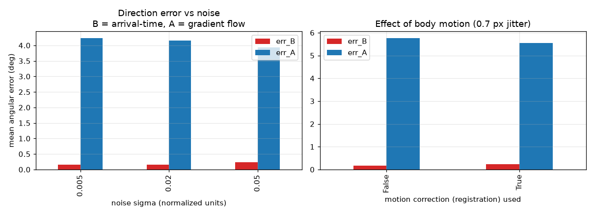
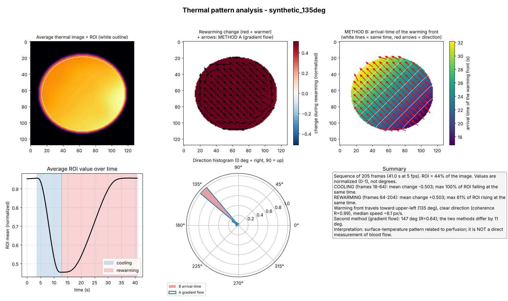

# Perfusion-Related Thermal Pattern Analysis from Thermal Image Sequences

An algorithm that analyses a **sequence of thermal images** frame by frame and estimates **where the skin warms or cools,
how fast, and in which direction (or around which foci) the thermal recovery spreads**, a pattern related to blood perfusion.

> Thermal cameras measure **surface temperature**, not blood flow. All outputs are *perfusion-related thermal patterns*,
> not blood-flow velocities and not a diagnosis (see [Scientific basis and limitations](#7-scientific-basis-and-limitations)).

**Use case:** perfusion-recovery mapping after skin cooling (dynamic infrared thermography).
**Dataset:** DIRT-SR38 (abdominal cooling-rewarming thermal sequences, 38 subjects).

---

## 1. Deliverables at a glance

| # | Deliverable (assignment) | Where to find it | How it is produced |
|---|---|---|---|
| 1 | Complete source code | [`src/`](src), [`scripts/`](scripts), [`app.py`](app.py) | this repository |
| 2 | Research papers and datasets referenced | `report/References_and_Datasets.md` and chapter 3 of the report | `python scripts/make_report.py ...` |
| 3 | Explanation of the proposed algorithm | `report/Algorithm_Explanation.md` and chapter 5 of the report; summary in [section 4](#4-how-the-algorithm-works) | `python scripts/make_report.py ...` |
| 4 | Results on at least two thermal sequences | `results/two_sequences/` (per sequence: video, figures, CSV, JSON) + `comparison.csv/png` | `python scripts/run_two_sequences.py ...` |
| 5 | Technical report (approach, results, limitations) | `report/Technical_Report.docx` | `python scripts/make_report.py ...` |
| 6 | Working demonstration | `results/*/demo.mp4` and the web app `streamlit run app.py` | see [section 6](#6-demonstration) |

| Expected output (assignment) | Where it appears |
|---|---|
| Frame-by-frame thermal analysis | `frame_by_frame.csv` (time, ROI mean, mean slope, % rising, % falling for every frame) and `demo.mp4` |
| Increasing / decreasing temperature regions | red = rising, blue = falling in the video; `rising_falling_over_time.png` |
| Estimated direction of thermal propagation | arrows and arrival-time map in `summary.png`; direction, speed and pattern class in `summary.json` |
| Visualisation of the detected patterns | heat maps, directional arrows, isochrones, direction histogram, annotated video |
| Summary of the overall pattern | `summary.txt` (plain-language summary per sequence) and `comparison.csv` |

---

## 2. Quick start (Windows)

```
cd Thermal-Image-Processing
python -m venv venv
venv\Scripts\activate
pip install -r requirements.txt
```

**Try it without any dataset (about 2 minutes):**
```
python -m src.pipeline --synthetic 135 --out results\synth_135
python scripts\evaluate_synth.py
streamlit run app.py
```

**Run it on the real dataset** (put each command on one line; `<FPS>` is the recording frame rate from the dataset paper):
```
python scripts\inspect_dataset.py "D:\Thermal\DIRT-SR38\dataset_export\8bit"
python scripts\preview_sequence.py "D:\Thermal\DIRT-SR38\dataset_export\8bit\P11\HR\dynamic"
python scripts\run_two_sequences.py --root "D:\Thermal\DIRT-SR38\dataset_export\8bit" --subjects P11 P12 --fps <FPS> --roi full --scale 0.5 --video_stride 5 --out results\two_sequences
python scripts\evaluate_synth.py
python scripts\make_report.py --seq_dir results\two_sequences --eval_dir results\evaluation --author "Your Name"
```
`--roi full` means the whole frame is skin (correct for close-ups such as DIRT-SR38). The default `--roi auto` looks for a body on a
background and is meant for whole-body recordings. A detailed guide with troubleshooting is in [`docs/USER_GUIDE.md`](docs/USER_GUIDE.md).

---

## 3. Pipeline: input and output of every step

| Step | Module | Input | Output / operation |
|---|---|---|---|
| 1 Load | `src/io_utils.py` | folder of PNG frames | `T[frames, H, W]`, values 0-1 |
| 2 Pre-process | `src/preprocess.py` | `T` | robust 0-1 scaling of the whole sequence, optional motion correction (ECC), Gaussian blur, temporal Savitzky-Golay smoothing |
| 3 ROI | `src/roi.py` | `T` | binary mask: whole frame (`full`) or Otsu body segmentation (`auto`) |
| 4 Frame-by-frame change | `src/temporal.py` | smoothed `T`, mask | per-pixel slope (units/s); noise level from frame differences; slope threshold = 3 x theoretical slope noise |
| 5 Rising / falling regions | `src/temporal.py` | slope maps | state +1 / -1 / 0 per pixel and frame; ROI curve; cooling and rewarming phases |
| 6 Direction and propagation | `src/flow.py` | smoothed `T`, slope, phase | arrival-time map, direction, speed (Method B); Lucas-Kanade gradient flow (Method A); early/late recovery foci; pattern class |
| 7 Summary and visualisation | `src/pipeline.py`, `src/viz.py` | everything above | figures, video, CSV, JSON, text summary |

---

## 4. How the algorithm works

After the skin is cooled, perfusion brings heat back and some places rewarm **earlier** than others. The algorithm measures the
*order* of recovery and derives direction and speed from it.

**Method B: arrival-time map (main method).** For each pixel, find the moment it reaches 50 % of its own change (the last moment it was still
short of that level, interpolated between frames). The direction in which this arrival time grows is the direction the pattern travels:

```
direction = grad(t) / |grad(t)|        speed = 1 / |grad(t)|        e.g. t = 12, 14, 16 s at x = 10, 20, 30 px  ->  right, 5 px/s
```

**Method A: gradient flow (independent check).** If a pattern moves with velocity **v**, a pixel's rate of change is `dT/dt = -(v . grad T)`.
This is solved per frame by least squares in a 15 x 15 window (Lucas-Kanade) and averaged over the phase; it also supplies the arrows of the video.

**Summary of the pattern.** Pixel directions are combined with circular statistics into a mean angle and a coherence **R** (1 = all arrows agree,
about 0 = no common direction). Because radial patterns (warming spreading away from a hot spot or vessel) have a low R by construction,
the algorithm also finds **early-recovery foci** (sources) and **late-recovery foci** (sinks) and measures how well the arrows point away
from / toward them. The result is one of three pattern classes:

| Class | Meaning |
|---|---|
| `uniform` | one dominant direction (R >= 0.6) |
| `focal` | warming spreads from early-recovery foci toward late ones (an alignment index >= 0.5) |
| `mixed` | no coherent propagation could be resolved: recovery is spatially heterogeneous |

Full explanation with formulas: `report/Algorithm_Explanation.md`.

---

## 5. Results

### 5.1 Validation on simulated sequences (known direction)

Real recordings have no ground truth for the propagation direction, so accuracy was measured on simulated cooling-rewarming sequences in which
a warming front with a chosen direction and speed crosses the body (noise, drift and motion included).
Reproduce with `python scripts/evaluate_synth.py` (outputs in `results/evaluation/`).

| Noise level (sigma) | Method B mean angular error | Method A mean angular error |
|---|---|---|
| 0.005 | 0.15 deg | 4.24 deg |
| 0.02 | 0.16 deg | 4.16 deg |
| 0.05 | 0.24 deg | 3.94 deg |

* 8 directions x 3 noise levels (24 runs): maximum error of Method B 0.48 deg; **100 %** of planar fronts classified `uniform`.
* Speed: estimated 6.09 px/s on average for a true 6.0 px/s.
* Body motion (0.7 px jitter): Method B 0.16 deg without and 0.23 deg with motion correction. The motion was small, so correction made no gain here.
* **Radial pattern** (warming spreading outward from one focus, 9 runs): classified `focal` in **100 %** of runs; the focus was located with a mean
  error of **0.61 px** (maximum 1.29 px) on a 128 px wide image; outward alignment 0.99.





*These are best-case numbers: the simulated front is clean and smooth. They show the implementation is correct and robust to noise; they do not
predict the error on real skin.*

### 5.2 Results on two real sequences (DIRT-SR38)

> Fill this table from your own run: `results/two_sequences/comparison.csv` and each `summary.txt`
> (`python scripts/make_report.py` prints the same numbers in the report). Replace every `...`.

| Sequence | Frames / fps | ROI | Pattern class | Direction (B) / R | Direction (A) / R | Speed (B) | Early / late foci |
|---|---|---|---|---|---|---|---|
| P11 (HR, dynamic) | ... | full | ... | ... | ... | ... | ... |
| P12 (HR, dynamic) | ... | full | ... | ... | ... | ... | ... |

Figures for each sequence (created by the run above):

| | P11 | P12 |
|---|---|---|
| Overview (ROI, change map, arrival-time map, arrows, histogram, summary) | `results/two_sequences/seq1_P11_HR_dynamic/summary.png` | `results/two_sequences/seq2_P12_HR_dynamic/summary.png` |
| Rising vs falling regions over time | `.../rising_falling_over_time.png` | `.../rising_falling_over_time.png` |
| Annotated video | `.../demo.mp4` | `.../demo.mp4` |
| Side-by-side comparison | `results/two_sequences/comparison.png` | |

**How to read a result:** red = getting warmer, blue = getting colder; white lines in the arrival-time map connect pixels that reached 50 %
at the same time; a star marks an early-recovery focus and an X a late-recovery focus. Trust a single direction only if the pattern class is
`uniform`. A `focal` or `mixed` result is a legitimate finding, not a failure: it says that no single travelling front is present in the data.

---

## 6. Demonstration

1. **Web app:** `streamlit run app.py`
   * *Synthetic demo:* choose a true direction, press **Run**; the app shows the estimated direction and its error (accuracy proof).
   * *Folder of images:* enter a sequence folder, the frame rate and ROI mode (`full` for close-ups); the app shows the summary, the annotated video,
     the rising/falling plot, the overview figure and the frame-by-frame table.
2. **Videos:** `results/*/demo.mp4` show, for every frame: the thermal image | rising (red) and falling (blue) regions with direction arrows | the ROI curve with a time marker.
3. **5-minute script:** (a) synthetic demo, direction 135 deg, show that the estimate matches; (b) real sequence, show video and summary text;
   (c) open `comparison.png`; (d) state the limitations below.

---

## 7. Scientific basis and limitations

**Basis.** Skin temperature results from heat delivered by blood perfusion, heat conducted from deeper tissue, and losses by radiation, convection and evaporation
(Pennes bioheat equation: `rho*c*dT/dt = k*laplacian(T) + w_b*rho_b*c_b*(T_a - T) + q_met`). After cooling, the speed of return toward equilibrium increases with perfusion `w_b`
and depends on conduction, so the spatial order of recovery carries perfusion-related information.

**Limitations.**
* Surface temperature only; deep vessels are blurred. A spreading warm patch is not necessarily blood travelling in that direction (conduction, tissue thickness, sweat, ambient conditions).
* DIRT-SR38 stores relative intensities, not degrees Celsius.
* No public ground truth for propagation direction: accuracy is shown on simulated data; real data can only show internal consistency (A vs B, subject vs subject).
* Arrival time reflects each pixel's own recovery speed; a smooth arrival-time gradient indicates propagation, a patchy map indicates local differences.
* The automatic body-on-background ROI is unsuitable for close-ups (use `--roi full`); motion correction is translation-only; thresholds are defaults, not clinically validated.
* Not a diagnostic tool and not validated against any clinical perfusion measurement.

---

## 8. Datasets and references

* **Dataset:** DIRT-SR38: Real Paired Cross-Sensor Thermal Sequence Dataset, Zenodo, DOI [10.5281/zenodo.19241293](https://doi.org/10.5281/zenodo.19241293), CC BY-NC 4.0
  (38 subjects, 30,780 aligned low-/high-resolution pairs, standardized abdominal cooling-rewarming protocol, 8-/16-bit PNG, relative intensities).
  Companion paper: Clarys et al., CVPR Workshops 2026 (cite as requested on the dataset page).
* **Provided with the assignment:** [Journal of Thermal Biology 2023 article](https://www.sciencedirect.com/science/article/abs/pii/S0306456523000050);
  [Sensors 2020, PMC7248891](https://pmc.ncbi.nlm.nih.gov/articles/PMC7248891/) (thermal imaging of emotional competences in nursing students).
* **Methods:** Pennes 1948 (bioheat); Ring & Ammer 2012 (thermal imaging in medicine); Garbey et al. 2007 (thermal imagery, cardiac pulse); Otsu 1979; Savitzky & Golay 1964;
  Lucas & Kanade 1981; Horn & Schunck 1981; Evangelidis & Psarakis 2008 (ECC); Mardia & Jupp 2000 (directional statistics).
* The complete list with bibliographic details is generated in `report/References_and_Datasets.md`.

---

## 9. Project structure

```
app.py                      demo web app (Streamlit)
src/
  io_utils.py               step 1  load images / video / .npy
  dirt.py                   DIRT-SR38 folder layout helpers, LR/HR pairing
  preprocess.py             step 2  scaling, motion correction, denoising, temporal smoothing
  roi.py                    step 3  region of interest (auto / full frame)
  temporal.py               steps 4-5  slope maps, rising/falling states, phases
  flow.py                   step 6  arrival-time (B), gradient flow (A), foci, pattern class
  viz.py                    step 7  figures and video
  pipeline.py               runs all steps, writes outputs (CLI: python -m src.pipeline)
  synth.py                  simulated sequences with known direction (planar / radial)
scripts/
  inspect_dataset.py        shows how the dataset is organised
  preview_sequence.py       checks ROI and curve of one sequence before analysis
  run_two_sequences.py      analyses two subjects and compares them
  evaluate_synth.py         accuracy evaluation on simulated data
  make_report.py            builds the Word report, algorithm explanation and references
  train_sr.py               optional: super-resolution model on the LR/HR pairs (PyTorch)
  sr_downstream_test.py     optional: does super-resolution help the direction estimate?
results/                    outputs of the runs
report/                     generated deliverable documents
docs/USER_GUIDE.md          detailed step-by-step guide and troubleshooting
```

---

## 10. Testing status

* Tested: the whole pipeline, evaluation, report generation and the web app on simulated sequences and on fake copies of the DIRT-SR38 folder layout (loader, LR/HR pairing, preview, two-sequence run).
* Real DIRT-SR38 sequences could not be run in the environment where this code was built. The numbers in section 5.2 must come from your own run with `--roi full` (results from earlier runs that used the automatic ROI are not valid for these close-up recordings).
* **Not executed:** `scripts/train_sr.py` and `scripts/sr_downstream_test.py` (they need PyTorch; syntax-checked only). They are optional extensions.

## License and citation

Code: see `LICENSE`. Dataset: CC BY-NC 4.0, cite the DOI and the companion paper above when using it.
